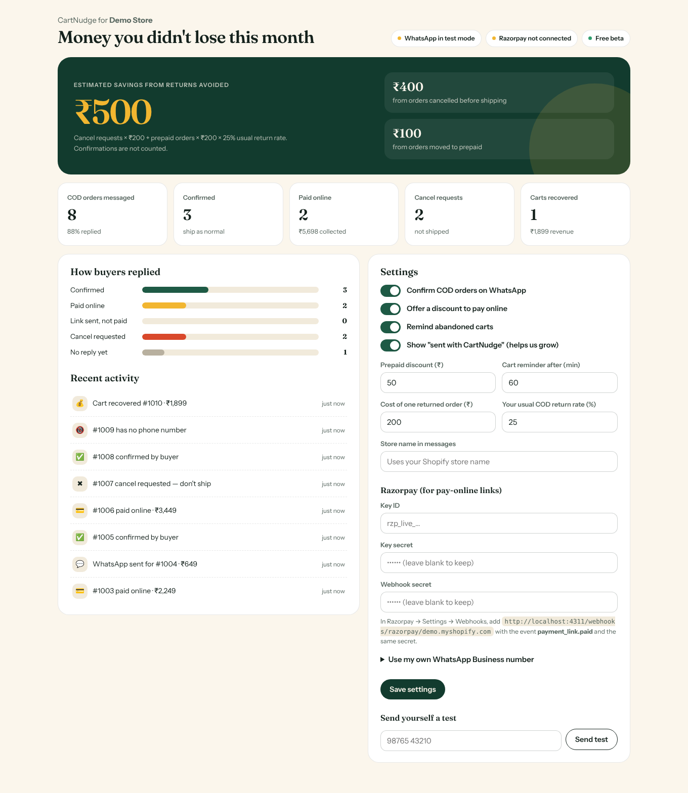

# CartNudge

**WhatsApp COD confirmation, prepaid nudges and cart reminders for Indian Shopify stores.**

Every cash-on-delivery order gets a WhatsApp message within seconds with three buttons:

| Buyer taps | What CartNudge does |
|---|---|
| ✅ Confirm order | Tags the Shopify order `cn-cod-confirmed` and thanks the buyer |
| 💳 Pay online & save ₹50 | Sends a discounted Razorpay payment link on the store's own account; when paid, tags `cn-paid-online` and notes "ship as prepaid" |
| ✖ Cancel order | Tags `cn-cod-cancel-requested` and adds a "do not ship" note. It never cancels anything by itself |

Abandoned checkouts get one WhatsApp reminder after a delay the store chooses (default 60 minutes). Clicks and recovered orders are tracked.

The embedded dashboard in Shopify admin shows estimated savings, how buyers replied, recent activity and all settings.



## How the savings number is calculated

It's deliberately conservative:

```
saved = cancel requests × cost per returned order
      + orders moved to prepaid × cost per returned order × usual COD return rate
```

Confirmations are not counted. The store sets both inputs in settings (defaults ₹200 and 25%).

## Stack

Plain Node.js 20+ with no runtime dependencies. One process handles HTTP, webhooks and a cart-reminder sweep every 5 minutes.

```
src/
  server.mjs     HTTP routes: OAuth install, embedded app, dashboard API, webhooks, cart redirect
  engine.mjs     business logic (COD flow, replies, payments, carts, stats); outside services injected
  shopify.mjs    OAuth, HMAC checks, Admin GraphQL (tags, notes, webhooks, billing), order helpers
  whatsapp.mjs   WhatsApp Cloud API client, signature check, inbound parsing, button payloads
  razorpay.mjs   payment links on the merchant's account, webhook check
  crypto.mjs     AES-256-GCM for secrets at rest, App Bridge session-token check
  store.mjs      JSON-file store with atomic writes and webhook de-duplication
public/          landing page (index.html) and embedded dashboard (app.html)
test/            node:test suite (`npm test`)
```

## Security

- Every webhook is signature-checked: Shopify (HMAC-SHA256 base64), WhatsApp (`X-Hub-Signature-256`), and Razorpay (a per-store secret on a per-store URL).
- Each webhook is processed once (de-duplicated by delivery id). Work runs after the 200 response, so Shopify's 5-second limit is never missed.
- A button tap only counts if it comes from the phone number the message was sent to.
- Shopify access tokens, Razorpay secrets and WhatsApp tokens are encrypted at rest (AES-256-GCM with `APP_SECRET`) and never sent to the browser.
- The dashboard API accepts only Shopify App Bridge session tokens (HS256, audience and expiry checked).
- All three mandatory privacy webhooks are handled. `shop/redact` deletes everything for that store.

## Run it locally (no Shopify needed)

```bash
cp .env.example .env          # leave the keys blank
DEV_SHOP=demo.myshopify.com npm run dev
```

Open http://localhost:3000 for the landing page and http://localhost:3000/app for the dashboard with demo data.

```bash
npm test                      # 28 tests
```

## Go live: step by step

1. **Deploy.** On Render, use `render.yaml` (Starter plan with a 1 GB disk), or any host that runs the `Dockerfile`. You'll get a URL like `https://cartnudge.onrender.com`.
2. **Create the Shopify app.** In the Shopify Partner Dashboard, go to Apps → Create app → Create app manually. Set:
   - App URL: `https://YOUR_URL/app`
   - Redirect URL: `https://YOUR_URL/auth/callback`
   - Privacy webhooks, all three: `https://YOUR_URL/webhooks/shopify`
   - Copy the Client ID and secret into `SHOPIFY_API_KEY` and `SHOPIFY_API_SECRET`. Set `APP_URL`.
   - Or fill in `shopify.app.toml` and run `shopify app deploy`.
3. **Set up WhatsApp.** In Meta for Developers, create an app and add WhatsApp. Then:
   - Add a phone number and copy its Phone number ID and a permanent System User token into `WA_PHONE_NUMBER_ID` and `WA_ACCESS_TOKEN`.
   - Copy the App secret into `WA_APP_SECRET`.
   - Create the three templates in [docs/whatsapp-templates.md](docs/whatsapp-templates.md) and point the webhook to `https://YOUR_URL/webhooks/whatsapp`.
4. **Install on a development store:** `https://YOUR_URL/auth?shop=your-dev-store.myshopify.com`.
5. **Connect Razorpay** in the dashboard settings (Key ID, Key secret, Webhook secret). Then add the shown webhook URL in Razorpay with the event `payment_link.paid`.
6. **Test it.** Place a COD test order with your own number and tap each button.
7. **Turn on billing** when you're ready: `BILLING_REQUIRED=true` and `BILLING_LIVE=true`.

## Limits to know

- The JSON store suits one instance with a persistent disk. Move to Postgres before running more than one instance.
- WhatsApp conversation charges from Meta are paid by whoever owns the sending number.
- Templates are English only for now. Add Hindi and Hinglish templates and pick by store setting next.
